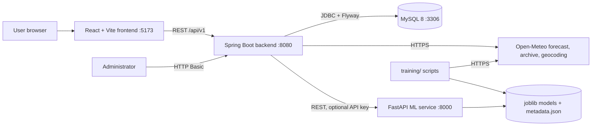

# Architecture

## Components

| Part | Responsibility |
|---|---|
| `frontend/` | Dashboard, charts, map, alert centre, admin form. Never calls the weather provider directly; it only talks to the backend. |
| `backend/` | Provider access with timeouts/retries/caching, rule-based risk engine, alert storage, ML proxy, security, rate limiting, snapshot retention. |
| `ml-service/` | Training pipeline (`training/`) and inference API (`app/`). Feature code is shared by both, which prevents train/serve skew. |
| MySQL | Locations, forecast snapshots, risk assessments, administrator-entered alerts. Schema owned by Flyway. |

## Three kinds of output (kept separate everywhere)

1. **Provider forecast** – Open-Meteo values shown unchanged.
2. **Rule-based risk screening** – `RiskEngine` applies configurable thresholds to (1). Not a trained model, not official.
3. **ML estimate** – next-day rainfall and heavy-rain flag from the trained model, from past observations only.

Official alerts are a fourth, separate thing: entered by an administrator with a source link and labelled
"administrator-entered, not automatically verified".

## Key design decisions

* **Provider abstraction** – `WeatherProvider` interface; `OpenMeteoProvider` is the only implementation.
* **Resilience** – connect/read timeouts, max 3 attempts with backoff for 5xx/network errors, no retry on 429.
  If the provider fails and a cached forecast younger than 12 h exists, it is served with `stale=true` and the UI says so;
  otherwise the API returns `503 weather_provider_unavailable`.
* **Caching** – in-memory, ~1 km cells (coordinates rounded to 2 decimals), 30 min TTL (configurable).
* **No fabricated data** – missing provider values stay `null`; the risk engine returns `INSUFFICIENT_DATA` rather than `LOW`.
* **Security** – public read-only endpoints; `/api/v1/admin/**` needs HTTP Basic for the single ADMIN user whose BCrypt hash comes from the environment (no hash = admin API disabled). Stateless, CORS allow-list, per-IP rate limit.
* **Retention** – a nightly job deletes forecast snapshots and risk assessments older than `SNAPSHOT_RETENTION_DAYS` (default 90).

## Intentionally omitted from the first release

* User registration/login and server-side saved locations (saved locations live in the browser's local storage).
* E-mail / push notifications (the in-app alert centre is implemented; test alerts are supported and visibly labelled).
* Automatic import of IMD warnings (no documented, permitted machine-readable feed was verified – see `data-sources.md`).
* Flood prediction (no terrain, drainage or river data).
* `model_versions` / `model_evaluation_runs` tables: model metadata is stored in `ml-service/models/metadata.json` instead.
