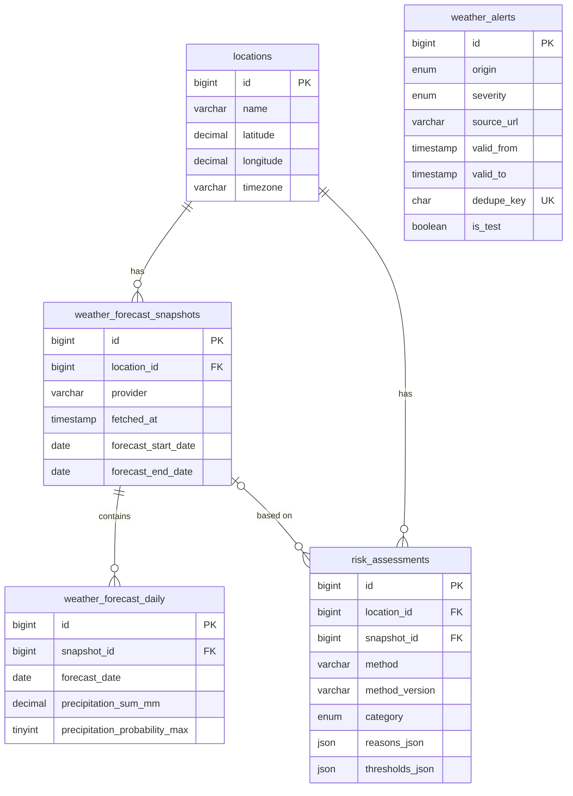

# Database

MySQL 8, InnoDB, utf8mb4. Schema = `backend/src/main/resources/db/migration/V1__core_schema.sql` (Flyway applies it automatically at startup).
The migration was applied to a real MySQL 8.0 server and its CHECK, UNIQUE and cascade rules were exercised (see `testing-report.md`).

* Indexes: `(location_id, fetched_at)`, `fetched_at`, `(location_id, created_at)`, `category`, alert validity `(valid_from, valid_to)`, severity, unique `dedupe_key`.
* Constraints: coordinate ranges, probability ≤ 100, non-negative rainfall, `valid_to > valid_from`, alert area all-or-none.
* Deleting a location cascades to its snapshots, daily rows and assessments; deleting a snapshot sets `risk_assessments.snapshot_id` to NULL.
* Retention: nightly job removes snapshots and assessments older than `SNAPSHOT_RETENTION_DAYS`.
* No passwords or personal data are stored (the admin password hash lives only in an environment variable).
* `weather_alerts.origin`: `ADMIN_ENTERED_OFFICIAL` (typed in by an admin; not auto-verified) vs `SYSTEM_GENERATED` (reserved; system estimates are computed on request and not stored, which avoids duplicates).
